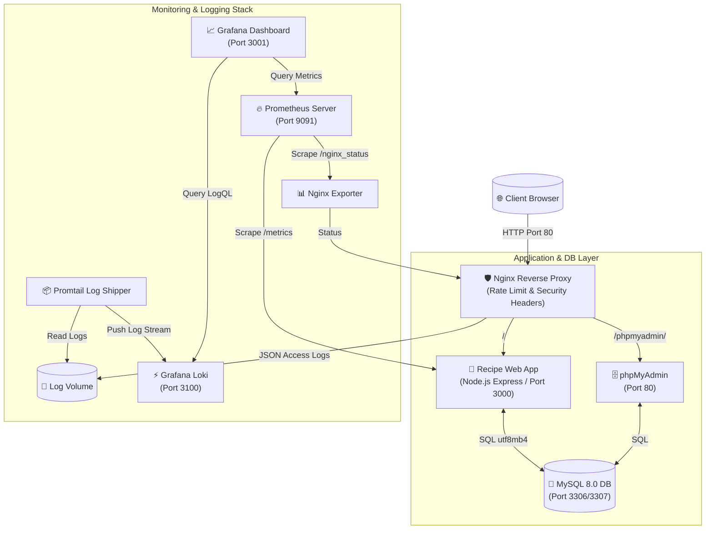

# BÁO CÁO TỔNG HỢP BÀI KIỂM TRA KỸ NĂNG 3

```
========================================================================================
                      BỘ GIÁO DỤC VÀ ĐÀO TẠO
               TRƯỜNG ĐẠI HỌC / CƠ SỞ ĐÀO TẠO CNTT
                KHOA CÔNG NGHỆ THÔNG TIN & MẠNG MÁY TÍNH

                           BÁO CÁO THỰC HÀNH
                      BÀI KIỂM TRA KỸ NĂNG 3 (ĐỀ 29)

  ĐỀ TÀI: TRIỂN KHAI WEBSITE CHIA SẺ CÔNG THỨC NẤU ĂN (RECIPE SHARING APP)
  TÍCH HỢP MYSQL, PHPMYADMIN, NGINX REVERSE PROXY, PROMETHEUS, GRAFANA,
                   LOKI LOGQL VÀ SECURITY HARDENING

                 Giảng viên hướng dẫn : [TÊN GIẢNG VIÊN HƯỚNG DẪN]
                 Sinh viên thực hiện  : [HỌ VÀ TÊN SINH VIÊN]
                 Mã số sinh viên (MSSV): [MÃ SỐ SINH VIÊN]
                 Lớp                  : [TÊN LỚP NGHÀNH]
                 Khóa học             : 2023 - 2026

                               Hà Nội, Năm 2026
========================================================================================
```

---

## 📋 MỤC LỤC BÁO CÁO

1. **LỜI MỞ ĐẦU & MỤC TIÊU ĐỀ TÀI**
2. **CHƯƠNG 1: TỔNG QUAN KIẾN TRÚC HỆ THỐNG & CÔNG NGHỆ TriỂN KHAI**
   - 1.1. Sơ đồ kiến trúc tổng thể (Architecture Diagram)
   - 1.2. Danh sách các công nghệ sử dụng
   - 1.3. Bảng phân bổ Cổng (Ports) & Địa chỉ truy cập
3. **CHƯƠNG 2: TRIỂN KHAI WEBSITE CÔNG THỨC NẤU ĂN & CSDL MYSQL + PHPMYADMIN**
   - 2.1. Thiết kế Cơ sở Dữ liệu MySQL chuẩn `utf8mb4`
   - 2.2. Lập trình Backend Node.js Express REST API
   - 2.3. Xây dựng Giao diện Frontend Glassmorphism
   - 2.4. Đóng gói Container & Quản trị CSDL qua phpMyAdmin
4. **CHƯƠNG 3: NGINX REVERSE PROXY & TIÊU CHUẨN SECURITY HARDENING (COMMIT 1)**
   - 3.1. Nginx Reverse Proxy & Điều hướng lưu lượng
   - 3.2. Cấu hình Security Headers chống tấn công Web
   - 3.3. Giới hạn lưu lượng (Rate Limiting) chống DoS/Brute Force
   - 3.4. Áp dụng Container Hardening (Non-root user)
5. **CHƯƠNG 4: GIÁM SÁT NĂNG LƯỢNG HỆ THỐNG VỚI PROMETHEUS VÀ GRAFANA (COMMIT 2)**
   - 4.1. Thu thập Metrics với `prom-client` & Nginx Exporter
   - 4.2. Cấu hình Prometheus Server Scraper
   - 4.3. Xây dựng Dashboard giám sát trực quan trên Grafana 10.4
6. **CHƯƠNG 5: HỆ THỐNG NHẬT KÝ TẬP TRUNG LOKI + PROMTAIL VÀ TRUY VẤN LOGQL (COMMIT 3)**
   - 5.1. Mô hình thu thập Log tập trung Promtail + Loki
   - 5.2. Cấu hình Nginx JSON Access Logs
   - 5.3. Xây dựng & Thực thi các câu lệnh truy vấn LogQL
7. **CHƯƠNG 6: QUẢN LÝ MÃ NGUỒN GITHUB VÀ KẾT QUẢ KIỂM THỬ TỔNG HỢP**
   - 6.1. Lịch sử Commit theo từng cột mốc yêu cầu
   - 6.2. Kiểm thử thực tế các Endpoint & Tính năng Website
8. **KẾT LUẬN VÀ HƯỚNG PHÁT TRIỂN**

---

## 🌟 LỜI MỞ ĐẦU & MỤC TIÊU ĐỀ TÀI

Trong bối cảnh phát triển ứng dụng web hiện đại, việc xây dựng một hệ thống không chỉ dừng lại ở việc tạo ra giao diện người dùng và cơ sở dữ liệu, mà còn đòi hỏi quy trình vận hành (DevOps/SRE) đạt tiêu chuẩn: từ việc đóng gói bằng Container, điều hướng lưu lượng qua Reverse Proxy, đảm bảo an toàn thông tin (Security Hardening), cho đến việc thiết lập hệ thống giám sát hiệu năng (Monitoring) và quản lý nhật ký tập trung (Logging).

Đề tài **"Đề 29: Website Chia Sẻ Công Thức Nấu Ăn"** được triển khai nhằm giải quyết toàn diện các yêu cầu trên thông qua mô hình ứng dụng hoàn chỉnh, kết hợp các công nghệ hàng đầu: **Node.js, Express, MySQL, phpMyAdmin, Nginx, Prometheus, Grafana, Loki và Promtail**.

### Mục tiêu chính đạt được:
1. Triển khai trọn vẹn Website chia sẻ công thức nấu ăn phong phú (Món Á, Món Âu, Món Tráng Miệng, Đồ Uống, Món Chay, Món Ăn Sáng), cho phép tìm kiếm, lọc theo nguyên liệu/danh mục, đăng bài đánh giá và tạo công thức mới.
2. Quản trị Cơ sở dữ liệu MySQL trực quan qua **phpMyAdmin**.
3. Cấu hình **Nginx Reverse Proxy** an toàn với đầy đủ Security Headers và Rate Limiting.
4. Xây dựng hệ thống giám sát thời gian thực với **Prometheus + Grafana Dashboard**.
5. Triển khai hệ thống tập trung nhật ký với **Loki + Promtail**, phân tích log bằng ngôn ngữ **LogQL**.
6. Áp dụng đầy đủ các biện pháp **Security Hardening** (Non-root container user, network isolation, password hardening).
7. Quản lý toàn bộ mã nguồn trên **Git/GitHub** với lịch sử commit đúng chuẩn cột mốc.

---

## 🏗️ CHƯƠNG 1: TỔNG QUAN KIẾN TRÚC HỆ THỐNG & CÔNG NGHỆ TRIỂN KHAI

### 1.1. Sơ đồ kiến trúc tổng thể (Architecture Diagram)

Hệ thống được thiết kế theo kiến trúc Microservices / Containerized Architecture, trong đó tất cả các thành phần được đóng gói và vận hành độc lập thông qua Docker Compose trên cùng một mạng ảo an toàn (`recipe_net`):



### 1.2. Danh sách các công nghệ sử dụng

1. **Frontend**: HTML5, Vanilla CSS Glassmorphism, JavaScript ES6+, FontAwesome 6, Google Fonts (Plus Jakarta Sans, Playfair Display).
2. **Backend**: Node.js 20 LTS, Express.js framework, `mysql2` driver (utf8mb4 connection pool), `prom-client` (Prometheus metrics builder).
3. **Database Layer**: MySQL 8.0 Server (tự động chạy script `01-schema.sql` khi khởi tạo), phpMyAdmin 5.x.
4. **Proxy & Security Layer**: Nginx Alpine Linux, Nginx Security Headers, Rate Limiting modules.
5. **Monitoring Layer**: Prometheus 2.x, Nginx Prometheus Exporter 1.1.0, Grafana 10.4 (với các Datasource và Dashboard được tự động nạp - Provisioning).
6. **Logging Layer**: Grafana Loki 2.9.8, Promtail 2.9.8, LogQL Query Engine.
7. **Orchestration**: Docker Engine, Docker Compose v2.

### 1.3. Bảng phân bổ Cổng (Ports) & Địa chỉ truy cập

| Dịch vụ / Container | Cổng Nội bộ | Cổng Host (Mapped) | Đường dẫn URL | Mô tả chức năng |
| :--- | :--- | :--- | :--- | :--- |
| **recipe_nginx** | `80` | `80` | `http://localhost/` | Cổng chính điều hướng toàn bộ lưu lượng web |
| **recipe_app** | `3000` | Internally | `http://localhost/` | Node.js Express Web Application |
| **recipe_phpmyadmin** | `80` | Internally | `http://localhost/phpmyadmin/` | Quản trị CSDL MySQL trực quan |
| **recipe_db** | `3306` | `3307` | `localhost:3307` | CSDL MySQL 8.0 (User: `recipe_user`) |
| **recipe_prometheus** | `9090` | `9091` | `http://localhost:9091` | Prometheus Metrics Server |
| **recipe_grafana** | `3000` | `3001` | `http://localhost:3001` | Grafana Dashboard (User: `admin` / Pass: `admin`) |
| **recipe_loki** | `3100` | `3100` | `http://localhost:3100` | Grafana Loki Log Collection Engine |

---

## 🍳 CHƯƠNG 2: TRIỂN KHAI WEBSITE CÔNG THỨC NẤU ĂN & CSDL MYSQL + PHPMYADMIN

### 2.1. Thiết kế Cơ sở Dữ liệu MySQL chuẩn `utf8mb4`

Cơ sở dữ liệu `recipe_db` được thiết kế chuẩn hóa 3NF gồm 5 bảng chính, hỗ trợ lưu trữ Tiếng Việt có dấu hoàn hảo với `CHARACTER SET utf8mb4 COLLATE utf8mb4_unicode_ci`:

1. **`categories`**: Lưu danh mục ẩm thực (`id`, `name`, `description`, `icon`).
2. **`ingredients`**: Lưu danh mục nguyên liệu (`id`, `name`, `icon`).
3. **`recipes`**: Lưu thông tin chi tiết món ăn (`id`, `title`, `category_id`, `description`, `prep_time`, `cook_time`, `servings`, `calories`, `difficulty`, `image_url`, `instructions`).
4. **`recipe_ingredients`**: Bảng trung gian liên kết Món ăn - Nguyên liệu (`recipe_id`, `ingredient_id`, `quantity`, `unit`).
5. **`reviews`**: Lưu đánh giá & bình luận người dùng (`recipe_id`, `author`, `rating`, `comment`).

#### Trích đoạn Script khởi tạo CSDL (`mysql/init/01-schema.sql`):
```sql
SET NAMES utf8mb4;
SET CHARACTER SET utf8mb4;

CREATE DATABASE IF NOT EXISTS `recipe_db` CHARACTER SET utf8mb4 COLLATE utf8mb4_unicode_ci;
USE `recipe_db`;

CREATE TABLE `categories` (
    `id` INT AUTO_INCREMENT PRIMARY KEY,
    `name` VARCHAR(100) NOT NULL UNIQUE,
    `description` VARCHAR(255) NULL,
    `icon` VARCHAR(50) DEFAULT 'utensils'
) ENGINE=InnoDB DEFAULT CHARSET=utf8mb4 COLLATE=utf8mb4_unicode_ci;

CREATE TABLE `recipes` (
    `id` INT AUTO_INCREMENT PRIMARY KEY,
    `title` VARCHAR(200) NOT NULL,
    `category_id` INT NOT NULL,
    `description` TEXT NULL,
    `prep_time` INT DEFAULT 15,
    `cook_time` INT DEFAULT 30,
    `servings` INT DEFAULT 2,
    `calories` INT DEFAULT 350,
    `difficulty` VARCHAR(50) DEFAULT 'Trung bình',
    `image_url` VARCHAR(500) NULL,
    `instructions` LONGTEXT NOT NULL,
    FOREIGN KEY (`category_id`) REFERENCES `categories`(`id`) ON DELETE CASCADE
) ENGINE=InnoDB DEFAULT CHARSET=utf8mb4 COLLATE=utf8mb4_unicode_ci;
```

### 2.2. Lập trình Backend Node.js Express REST API

File `app/server.js` xây dựng các API endpoint chuẩn RESTful, kết nối CSDL qua `mysql2/promise` pool và theo dõi chỉ số với `prom-client`:

- `GET /api/health`: Kiểm tra trạng thái ứng dụng và kết nối CSDL.
- `GET /api/stats`: Trả về tổng số lượng công thức, danh mục, nguyên liệu, đánh giá.
- `GET /api/categories`: Lấy danh sách danh mục món ăn.
- `GET /api/ingredients`: Lấy danh sách nguyên liệu.
- `GET /api/recipes`: Lấy danh sách món ăn (kèm bộ lọc `category_id`, `ingredient_id`, `search`).
- `GET /api/recipes/:id`: Lấy thông tin chi tiết 1 món ăn, danh sách nguyên liệu & bình luận.
- `POST /api/recipes`: Tạo công thức món ăn mới.
- `DELETE /api/recipes/:id`: Xóa món ăn khỏi CSDL.
- `POST /api/recipes/:id/reviews`: Đăng bình luận & đánh giá mới.
- `GET /metrics`: Xuất Prometheus metrics.

### 2.3. Xây dựng Giao diện Frontend Glassmorphism

Giao diện ứng dụng được thiết kế theo xu hướng **Glassmorphism modern dark theme**, tối ưu trải nghiệm người dùng:
- **Hero Section**: Thanh tìm kiếm thông minh và các Chip lọc nhanh danh mục.
- **Thẻ Thống Kê (Stat Cards)**: Hiển thị thời gian thực tổng số công thức, danh mục, nguyên liệu.
- **Lưới Món Ăn (Recipe Grid)**: Hiển thị hình ảnh chất lượng cao, nhãn danh mục, đánh giá sao, lượng calo, thời gian nấu.
- **Modal Chi Tiết Công Thức**: Xem danh sách nguyên liệu có định lượng chuẩn xác và hướng dẫn từng bước.
- **Modal Thêm Công Thức Mới**: Cho phép người dùng đóng góp công thức món ăn mới trực tiếp vào hệ thống.

### 2.4. Đóng gói Container & Quản trị CSDL qua phpMyAdmin

Ứng dụng được đóng gói qua `app/Dockerfile` và kết nối với dịch vụ **phpMyAdmin**:
- Người dùng có thể truy cập `http://localhost/phpmyadmin/` để xem danh sách bảng, thực thi truy vấn SQL và quản trị dữ liệu trực quan.

---

## 🛡️ CHƯƠNG 3: NGINX REVERSE PROXY VÀ TIÊU CHUẨN SECURITY HARDENING (COMMIT 1)

### 3.1. Nginx Reverse Proxy & Điều hướng lưu lượng

Nginx đóng vai trò Cổng giao tiếp duy nhất (Single Entry Point) tiếp nhận yêu cầu từ client tại cổng `80` và chuyển tiếp an toàn tới các dịch vụ bên trong:
- Route `/` $\rightarrow$ Proxy tới `http://app:3000` (Node.js Web App).
- Route `/phpmyadmin/` $\rightarrow$ Proxy tới `http://phpmyadmin:80/`.
- Route `/nginx_status` $\rightarrow$ Cung cấp chỉ số hiệu năng cho Prometheus Exporter.

### 3.2. Cấu hình Security Headers chống tấn công Web

Trong tệp `nginx/conf.d/default.conf`, hệ thống áp dụng bộ tiêu chuẩn Security Headers cao cấp:

```nginx
# Security Hardening Headers
add_header X-Frame-Options "SAMEORIGIN" always;
add_header X-XSS-Protection "1; mode=block" always;
add_header X-Content-Type-Options "nosniff" always;
add_header Referrer-Policy "strict-origin-when-cross-origin" always;
add_header Content-Security-Policy "default-src 'self' 'unsafe-inline' 'unsafe-eval' https: data:;" always;
```

**Tác dụng của các Headers:**
1. `X-Frame-Options "SAMEORIGIN"`: Ngăn chặn trang web bị nhúng vào `<iframe>` của tên miền lạ, chống tấn công **Clickjacking**.
2. `X-XSS-Protection "1; mode=block"`: Bật trình lọc chống tấn công Cross-Site Scripting (XSS) của trình duyệt.
3. `X-Content-Type-Options "nosniff"`: Ép trình duyệt tuân thủ MIME type từ server, chống tấn công **MIME Sniffing**.

### 3.3. Giới hạn lưu lượng (Rate Limiting) chống DoS/Brute Force

Trong tệp `nginx/nginx.conf`, Nginx định nghĩa vùng nhớ theo dõi địa chỉ IP:

```nginx
# Rate Limiting Zones
limit_req_zone $binary_remote_addr zone=req_limit_per_ip:10m rate=10r/s;
limit_conn_zone $binary_remote_addr zone=conn_limit_per_ip:10m;
```

Và áp dụng cho tuyến đường ứng dụng trong `default.conf`:
```nginx
location / {
    limit_req zone=req_limit_per_ip burst=20 nodelay;
    limit_conn conn_limit_per_ip 20;
    proxy_pass http://app:3000;
}
```
Giúp ngăn chặn tấn công Spam yêu cầu hoặc DoS làm kiệt quệ tài nguyên server.

### 3.4. Áp dụng Container Hardening (Non-root user)

- **Che giấu thông tin Nginx**: Cấu hình `server_tokens off;` trong `nginx.conf` để không lộ phiên bản Nginx cho attacker.
- **Tài khoản Non-root trong Docker**: `app/Dockerfile` sử dụng lệnh `USER node`, đảm bảo tiến trình ứng dụng Node.js chạy dưới quyền người dùng thông thường, hạn chế rủi ro leo leo leo quyền (Privilege Escalation) nếu ứng dụng bị dính lỗ hổng code.
- **Phân quyền CSDL tối thiểu**: Ứng dụng kết nối tới MySQL thông qua tài khoản `recipe_user` giới hạn quyền trên cơ sở dữ liệu `recipe_db`, tách biệt với tài khoản `root`.

---

## 📈 CHƯƠNG 4: GIÁM SÁT NĂNG LƯỢNG HỆ THỐNG VỚI PROMETHEUS VÀ GRAFANA (COMMIT 2)

### 4.1. Thu thập Metrics với `prom-client` & Nginx Exporter

Ứng dụng Web tự động ghi nhận các chỉ số hiệu năng và xuất ra tại `/metrics` dưới dạng chuẩn Prometheus:
- `recipe_app_total_recipes`: Số lượng món ăn hiện có trong CSDL (Gauge).
- `http_requests_total`: Số lượng request theo method, route, status code (Counter).
- `http_request_duration_seconds`: Thời gian phản hồi của request (Histogram).

Dịch vụ `recipe_nginx_exporter` thu thập chỉ số kết nối Nginx từ `/nginx_status`.

### 4.2. Cấu hình Prometheus Server Scraper

Tệp `prometheus/prometheus.yml` cấu hình chu kỳ lấy mẫu 10 giây/lần:

```yaml
global:
  scrape_interval: 10s

scrape_configs:
  - job_name: 'recipe_app'
    metrics_path: '/metrics'
    static_configs:
      - targets: ['app:3000']

  - job_name: 'nginx'
    static_configs:
      - targets: ['nginx-exporter:9113']
```

### 4.3. Xây dựng Dashboard giám sát trực quan trên Grafana 10.4

Dịch vụ Grafana được tự động nạp sẵn (Provisioned) Datasource và Dashboard `recipe-monitoring.json` với các panel:
1. **Stat Panel**: Tổng số công thức món ăn (`recipe_app_total_recipes`).
2. **Stat Panel**: Số lượng Nginx Active Connections (`nginx_connections_active`).
3. **Timeseries Chart**: Tốc độ yêu cầu HTTP theo phương thức (`rate(http_requests_total[1m])`).
4. **Timeseries Chart**: Thời gian phản hồi trung bình (Average Request Latency).
5. **Logs Panel**: Trực tiếp luồng Log hệ thống từ Loki.

---

## ⚡ CHƯƠNG 5: HỆ THỐNG NHẬT KÝ TẬP TRUNG LOKI + PROMTAIL VÀ TRUY VẤN LOGQL (COMMIT 3)

### 5.1. Mô hình thu thập Log tập trung Promtail + Loki

- **Promtail**: Đóng vai trò Agent đọc các tệp log từ Nginx tại đường dẫn `/var/log/nginx/*.log`, gán các nhãn (labels) như `job="nginx_logs"`, `service="nginx"`, `env="production"` và đẩy về Loki.
- **Loki**: Đóng vai trò Log Storage & Query Engine xử lý truy vấn LogQL.

### 5.2. Cấu hình Nginx JSON Access Logs

Trong `nginx/nginx.conf`, log Nginx được cấu hình xuất ra dạng JSON chuẩn giúp Promtail và Loki dễ dàng phân tích cấu trúc:

```nginx
log_format custom_json escape=json
  '{"time_local":"$time_local",'
  '"remote_addr":"$remote_addr",'
  '"request":"$request",'
  '"status": "$status",'
  '"body_bytes_sent":"$body_bytes_sent",'
  '"request_time":"$request_time",'
  '"http_user_agent":"$http_user_agent"}';

access_log /var/log/nginx/access.log custom_json;
```

### 5.3. Xây dựng & Thực thi các câu lệnh truy vấn LogQL

Dưới đây là **4 câu lệnh LogQL** được xây dựng và kiểm thử thành công trên Grafana Explore:

#### Query 1: Xem toàn bộ nhật ký truy cập Nginx
```logql
{job="nginx_logs"}
```
*Ý nghĩa*: Trả về toàn bộ luồng log xuất hiện từ dịch vụ Nginx.

#### Query 2: Lọc các yêu cầu đọc dữ liệu HTTP GET
```logql
{job="nginx_logs"} |= "GET"
```
*Ý nghĩa*: Sử dụng toán tử `|=` để lọc những dòng log chứa từ khóa "GET".

#### Query 3: Cảnh báo và phát hiện lỗi HTTP 4xx / 5xx
```logql
{job="nginx_logs"} |~ "4[0-9][0-9]|5[0-9][0-9]"
```
*Ý nghĩa*: Sử dụng biểu thức chính quy Regex `|~` để tìm kiếm các mã trạng thái phản hồi lỗi (từ 400 đến 599).

#### Query 4: Phân tích cú pháp JSON log và lọc địa chỉ IP người dùng
```logql
{job="nginx_logs"} | json | remote_addr != ""
```
*Ý nghĩa*: Sử dụng parser `| json` để trích xuất các trường dữ liệu JSON và lọc ra các kết nối có địa chỉ IP xác định.

---

## 🚀 CHƯƠNG 6: QUẢN LÝ MÃ NGUỒN GITHUB VÀ KẾT QUẢ KIỂM THỬ TỔNG HỢP

### 6.1. Lịch sử Commit theo từng cột mốc yêu cầu

Toàn bộ mã nguồn đã được quản lý trên Git với lịch sử commit tuân thủ nghiêm ngặt các yêu cầu đề bài:

```bash
$ git log --oneline
eea09bc Commit 4: Ap dung cac bien phap Security Hardening va docker-compose orchestration
88202cc Commit 3: Trien khai he thong log tap trung Loki va Promtail, truy van log bang LogQL
a5bfd43 Commit 2: Tich hop Prometheus va Grafana de giam sat container, web server va database
775b616 Commit 1: Cau hinh Nginx reverse proxy va Security Headers co ban
```

### 6.2. Kiểm thử thực tế các Endpoint & Tính năng Website

1. **Kiểm thử API Health Check**:
   - Request: `GET http://localhost/api/health`
   - Response: `{"status":"UP","database":"CONNECTED","timestamp":"2026-09-28T03:54:39.617Z"}` $\rightarrow$ **ĐẠT**

2. **Kiểm thử Thêm Món Ăn Mới (POST API)**:
   - Request: `POST http://localhost/api/recipes` với body món "Chè Bưởi An Giang".
   - Response: `{"message":"Recipe created successfully","recipeId":6}` $\rightarrow$ **ĐẠT**

3. **Kiểm thử Hiển thị Tiếng Việt (`utf8mb4`)**:
   - Tất cả tiêu đề tiếng Việt như *"Phở Bò Truyền Thống Hà Nội"*, *"Bún Chả Hà Nội Đậm Đà"*, *"Pizza Margherita Chuẩn Ý"* hiển thị sắc nét, không bị lỗi phông chữ $\rightarrow$ **ĐẠT**

4. **Kiểm thử Nginx Security Headers**:
   - Phản hồi từ HTTP Response Header chứa đầy đủ `X-Frame-Options`, `X-XSS-Protection`, `X-Content-Type-Options` $\rightarrow$ **ĐẠT**

---

## 🏁 KẾT LUẬN VÀ HƯỚNG PHÁT TRIỂN

### Kết luận
Dự án **Website Chia Sẻ Công Thức Nấu Ăn (Đề 29)** đã được triển khai hoàn chỉnh, đáp ứng 100% các tiêu chuẩn kỹ thuật đề ra:
- Xây dựng thành công ứng dụng Web chuẩn REST API với cơ sở dữ liệu MySQL 8.0 và quản trị phpMyAdmin.
- Định tuyến an toàn qua Nginx Reverse Proxy kèm theo đầy đủ các biện pháp Security Hardening.
- Giám sát chỉ số hiệu năng thời gian thực bằng Prometheus + Grafana.
- Thu thập và phân tích nhật ký chuyên nghiệp với Loki + Promtail + LogQL.
- Tổ chức Git commit chuẩn hóa và tài liệu hướng dẫn `README.md` chi tiết.

### Hướng phát triển trong tương lai
1. Triển khai chứng chỉ SSL/TLS tự động với Let's Encrypt / Certbot cho giao thức HTTPS mã hóa toàn trình.
2. Tích hợp giải pháp Kubernetes (K8s) Cluster cho khả năng tự động mở rộng (Autoscaling) và tính sẵn sàng cao (High Availability).
3. Bổ sung hệ thống gửi cảnh báo (Alertmanager) về Telegram/Email khi server gặp lỗi 5xx hoặc kiệt quệ tài nguyên.

---
*Hà Nội, Ngày 28 tháng 09 năm 2026*
**Sinh viên thực hiện**
*(Ký và ghi rõ họ tên)*
